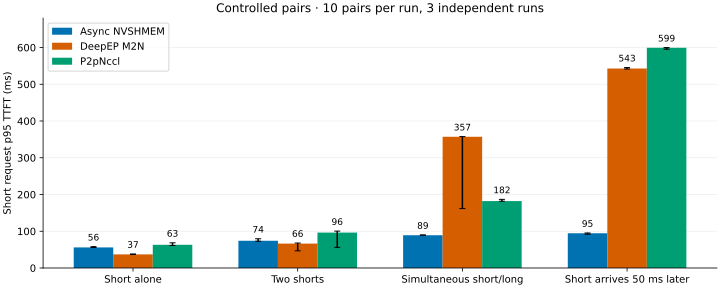
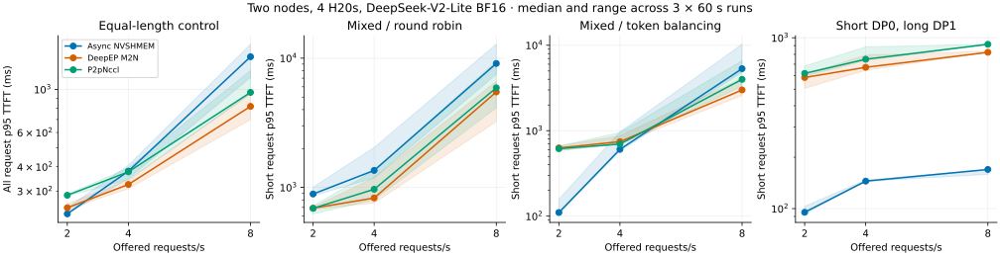

# Async GPU prefill imbalance benchmark

## Question and comparison

Does independent Attention progress improve short-request TTFT and sustainable
prefill throughput when different DP replicas receive uneven request lengths?
Compare `GpuAsyncAFDConnector` with **both** synchronous production connectors:
`DeepEPM2NAFDConnector` and `P2pNcclAFDConnector`.

The reference is the supplied
[ASAP paper, arXiv:2606.22541v1](https://arxiv.org/abs/2606.22541v1).
ASAP studies global MoE synchronization under DP imbalance and evaluates prefill
with Poisson arrivals, variable prompt lengths up to 32K and a 5-second TTFT SLO.
It combines asynchronous communication with length-aware batching, dual-batch
interleaving, communication overlap and a layer-oblivious expert kernel. This
connector implements only part of that system; the paper's CloudMatrix384/V3.2
speedup is not an expected result for four H20s and V2-Lite.

## Fixed controls, chosen before measurement

- Same two nodes (`vllm-sgp-h20-03`, `vllm-sgp-h20-04`), two H20s per node:
  Attention DP2/TP1 on the first, FFN DP2/TP1/EP2 on the second.
- Same DeepSeek-V2-Lite-Chat BF16 snapshot and weights (four shard SHA256 values
  match the previous qualification), seed 0, max model length 32768, token budget
  4096, max sequences 32, GPU memory utilization 0.5.
- Chunked prefill enabled for every arm; prefix caching disabled. Generate one
  token with EOS ignored. This measures prefill rather than mixed decode work.
- Native MRV2 `FULL_DECODE_ONLY` configuration, compilation mode 0; primary
  comparison has DBO disabled on every arm. FFN graph policies are the actual
  connector defaults. No execution probe, worker extension or per-layer debug
  logging is loaded for timing.
- Common Torch 2.13.0+cu130, vLLM 0.32.0 and NCCL **2.30.7** runtime. The latter
  is required by afdEP-comm 1.2.0. Torch's compiled NCCL version still reports
  2.29.7; record the loaded library/version separately. Use normal installation,
  not `LD_PRELOAD` (preloading caused CLI startup failures in this environment).
- DeepEP M2N uses its fast DeepGEMM BF16 backend, with the upstream DeepGEMM
  bundled in the pinned vLLM wheel when no standalone package is installed.
  Do not substitute its slow `fused_experts` reference backend.
- P2pNccl routes on FFN; the two routed connectors route on Attention. The three
  connectors also use different communication and expert implementations, so
  raw speedup alone does not isolate the effect of removing DP barriers.

## Workload and metrics

The reproducible client is [`prefill_skew.py`](../../tools/benchmarks/prefill_skew.py).
Synthetic token IDs are valid non-special vocabulary IDs, generated before the
timed window. All arms replay identical seeds, prompt lengths, DP destinations
and arrival timestamps; save each plan's SHA256 with raw request results.
The native `X-data-parallel-rank` header makes placement explicit.

1. Controlled pairs: short alone, two short requests, and a short/long pair on
   different replicas. Alternate which replica gets the short request. Measure
   the short request separately; an overall average can hide its waiting time.
   `long_inflight` sends the long request first and the short request 50 ms
   later, testing arrival during an existing prefill. Its short TTFT starts
   at the short request's scheduled arrival, excluding that intentional delay.
2. Open-loop Poisson arrivals with matched arrival times across profiles:
   balanced prompts of 3482 tokens; mixed prompts of 256/16384 tokens in a
   randomized 80/20 mix (mean 3481.6); and an explicit skew stress test placing
   short requests on DP0 and long requests on DP1.
   A fourth control, `token_balanced`, reuses mixed lengths and greedily assigns
   each arrival to the DP rank with fewer cumulative input tokens. This fixed
   plan does not use runtime queue feedback; it checks whether the result relies
   on request-count balancing or deliberately skewed routing.
3. Primary metrics: short/long/all TTFT mean and p50/p95/p99, achieved RPS,
   input tokens/s, fraction within 5 seconds, and goodput within that SLO.
   Also report short-request fraction within the preselected 1-second bound.
   Include dispatch lag, errors and drain time; do not count dropped requests
   or client backlog as successful throughput.
   Completed throughput and `goodput_5s_rps` include the full drain in their
   denominator. `arrival_window_goodput_*` instead divides SLO-compliant
   arrivals by the fixed offering window; retain both definitions, since slow
   long-request draining can hide short requests finishing promptly.

Pilot measurements select a common offered-rate grid for confirmation; pilot
results are kept separate. Confirmation uses repeated runs, with server order
rotated and no profiler active. Profiling is a separate diagnostic experiment.
Report balanced-load regressions as well as skewed-load benefits.

The confirmation grid, fixed after pilots and before confirmation, is 2/4/8
offered RPS for all four profiles, 60 seconds per point and three distinct seeds.
Each arm starts fresh for each round. Orders rotate async/M2N/P2P,
P2P/async/M2N, then M2N/P2P/async; profile and rate order also rotate. Each round
includes ten repetitions of all four pair scenarios. A separate five-minute
run checks `token_balanced` at 4 RPS after the grid, rather than treating a short
pilot as a sustainable-throughput result. Rates 16 RPS are retained only as
overload diagnostics: the pilot drains far beyond its offering window.

## Review changes before measurement

Connector-specific modules now live in `gpu/async_nvshmem/`, with mirrored unit
modules; generic `gpu/cuda_rt.py` stays shared. Resolve the window device through
the pinned platform's logical-to-visible device mapping, and cover a reversed
assignment with a real GPU graph test. The routed-experts interface reuse
suggestion is a separate design concern; folder movement does not claim that
interface unification is complete.

## Results

### Pilot and diagnosed overhead

These initial controlled pairs are diagnostic, not confirmation results. The
original async implementation uses three repetitions; each synchronous baseline
uses six. All requests succeeded. TTFT below is the short cohort's median.

| Connector | Short alone | Short/short pair | Short/long pair |
| --- | ---: | ---: | ---: |
| Async, full-capacity RMA | 128 ms | 130 ms | 234 ms |
| DeepEP M2N, DeepGEMM BF16 | 40 ms | 43 ms | 163 ms |
| P2pNccl | 53 ms | 55 ms | 181 ms |

The initial async candidate loses on absolute latency, including with imbalance.
A separate Nsight Systems CUDA-profiler-API capture, after warming the model,
contains ten short-alone and ten mixed pairs. Its Attention workers recorded
3120 publish kernels averaging **1.068 ms**, 3.333 seconds in total (21.9% of
aggregate CUDA kernel time); receive waits account for another 47.2%. These are
aggregated GPU times across workers, not fractions of end-to-end wall time.

The sender copied only valid rows into its outbox but transmitted the entire
maximum-capacity slot. With capacity 4096 and a 256-token request, most of that
traffic is unused. The candidate optimization sends each populated field prefix
at its original offset, using tensor shapes for lengths without a routing D2H.
Blocking payload puts, a device fence and header put-with-signal preserve the
publish ordering; quiet still protects outbox reuse. The wire layout stays v5,
but the Python/native bridge must be rebuilt together. This follows NVIDIA's
[NVSHMEM ordering contract](https://docs.nvidia.com/nvshmem/api/latest/using.html).

Confirmation results follow after transport regression and repeated matched
workloads; the pilot loss above is retained as the starting point.

### Confirmation: targeted latency benefit, throughput tradeoff

All **34,332 requests** completed without HTTP, stream or token-usage errors
(11,444 per connector). The grid contains 108 runs: 36 distinct arrival plans
replayed identically by all three arms. Four pair scenarios were repeated ten
times in each of three rounds. Each connector also completed the preselected
five-minute `token_balanced` check. Source/native-library SHA256 values remained
unchanged throughout confirmation.

The tables below use the **median of three per-run statistics**, not a pooled
percentile. The plots shade the full range across those three runs. The full
[per-run CSV](data/async_gpu_prefill_20261117.csv) and
[plan/source/profile manifest](data/async_gpu_prefill_20261117.json) retain the
other cohorts, errors, SLO fractions and both goodput definitions.

| Controlled scenario | Async short p95 | M2N short p95 | P2pNccl short p95 |
| --- | ---: | ---: | ---: |
| Short alone | 56 ms | 37 ms | 63 ms |
| Two shorts | 74 ms | 66 ms | 96 ms |
| Simultaneous short/long | 89 ms | 357 ms | 182 ms |
| Long first, short 50 ms later | **95 ms** | **543 ms** | **599 ms** |

The in-flight-long case improves short-request p95 by **5.7x versus M2N** and
**6.3x versus P2pNccl**. Its async run range is 92–95 ms, versus 541–545 ms for
M2N and 595–600 ms for P2pNccl. M2N's simultaneous-pair p95 is more variable
(162–358 ms); use the stable in-flight case for the main blocking conclusion.
Short-alone latency remains lower with M2N.



| Poisson scenario | Offered RPS | Async short p95 | M2N short p95 | P2pNccl short p95 |
| --- | ---: | ---: | ---: | ---: |
| Mixed, round robin | 4 | 1.353 s | 0.828 s | 0.967 s |
| Mixed, round robin | 8 | 9.104 s | 5.479 s | 5.900 s |
| Mixed, token balancing | 2 | **0.110 s** | 0.629 s | 0.616 s |
| Mixed, token balancing | 4 | **0.604 s** | 0.744 s | 0.698 s |
| Mixed, token balancing | 8 | 5.323 s | 2.998 s | 3.990 s |
| Short DP0, long DP1 | 4 | **0.145 s** | 0.672 s | 0.749 s |
| Short DP0, long DP1 | 8 | **0.169 s** | 0.822 s | 0.916 s |

This supports independent progress when another DP rank is busy. It does not
remove queues within the same DP rank: the round-robin mixed workload loses
against both synchronous baselines. Token balancing helps async at lower load,
but the synchronous implementations still have more headroom at 8 RPS.



| 8 RPS workload | Async completed RPS | M2N completed RPS | P2pNccl completed RPS |
| --- | ---: | ---: | ---: |
| Equal-length control | 7.644 | 7.684 | 7.654 |
| Mixed, round robin | 6.565 | 7.341 | 7.203 |
| Mixed, token balancing | 7.064 | 7.520 | 7.469 |
| Short DP0, long DP1 | 4.115 | 5.764 | 5.302 |

Completed throughput includes drain. In the skew stress at 8 RPS, async keeps
short p95 at 169 ms while long p95 grows to **50.1 s**, versus 19.4 s for M2N
and 26.1 s for P2pNccl. This is not an overall SLO-throughput win. The equal-length
control also has higher mean TTFT with async (581 ms versus 368/467 ms).

### Five-minute check

All arms replayed the same 1246 arrivals at nominal 4 RPS (realized 4.153 RPS),
with token-balanced routing. All requests met the 5-second TTFT bound; completed
throughput was effectively equal after drain.

| Metric | Async | M2N | P2pNccl |
| --- | ---: | ---: | ---: |
| Completed RPS | 4.137 | 4.139 | 4.137 |
| All-request mean TTFT | **464 ms** | 545 ms | 610 ms |
| Short mean TTFT | **245 ms** | 409 ms | 463 ms |
| Short p50 TTFT | **92 ms** | 437 ms | 489 ms |
| Short p95 TTFT | 924 ms | **841 ms** | 929 ms |
| Short fraction within 1 s | 96.59% | 98.09% | 95.78% |
| Long p95 TTFT | 1.757 s | **1.560 s** | 1.712 s |

Async improves average and median waiting time here, with no measured throughput
increase. Its short tail remains worse than M2N. These are workload-specific
latency gains; they do not reproduce ASAP's complete system or its throughput
claim.

### Profile and next implementation work

Matched Nsight captures contain 3120 publish kernels each. The first 520 belong
to the ten short-alone trials, before the client starts mixed pairs. Their mean
publish duration falls from **1.071 ms to 0.169 ms (6.35x)**; aggregate publish
time across both short and long work falls from 3.333 s to 2.563 s. The after
capture also enables a separate FFN Torch diagnostic, so profiled request
latencies and wait-time fractions are not used as confirmation measurements.

The FFN diagnostic shows many flag-poll kernels, D2H copies and launches. Its
sampled interval has no graph launches. The current default bucket ladder starts
at 3072 routed rows for this configuration, while a 256-token request averages
768 rows per FFN; this explains an eager path for these small requests. This is
an inference from the captured interval and bucket policy, not a claim that every
FFN transaction runs eagerly.

The next priorities supported by these measurements are:

1. Cover small routed batches with suitable local expert graph buckets, and
   measure padding versus launch cost instead of applying a V4 calibration to
   every model/size.
2. Share a fast local expert executor with M2N, preserving async's FP32 routing
   weights and combine. Matching expert kernels would better isolate the cost
   of synchronization from the current DeepGEMM/native-modular difference.
3. Reduce host polling and header readback, then consider opportunistic work
   coalescing and communication overlap. A connector alone does not supply
   ASAP's batching and layer-oblivious MoE execution.
4. Validate a production length trace and larger model/topology before claiming
   general serving or scaling gains.

### Reproduction and validation

Reserve two nodes with two H20 GPUs each through Slurm; keep the model snapshot
in node-local scratch. With the qualified CUDA extension, pinned vLLM and afdEP
installed, run one arm at a time:

```bash
.venv/bin/python tools/benchmarks/run_prefill_skew_slurm.py async \
  --job-id "$SLURM_JOB_ID" \
  --attention-host "$ATTENTION_HOST" --ffn-host "$FFN_HOST" \
  --model "$LOCAL_MODEL_PATH" --output .venv/prefill-async \
  -- --mode both --profiles balanced mixed token_balanced skewed \
  --rates 2 4 8 --duration 60 --repeats 1 --pairs 10 --seed 20261117
```

Repeat with `m2n` and `p2p`, then the manifest's other two seeds and orders.
Use `--profiles token_balanced --rates 4 --duration 300 --repeats 1
--seed 20262117` for the five-minute check. The launcher saves server/client
commands, health readiness, raw requests, plan hashes and teardown results, and
removes inherited AFD profiler/debug settings. Every measured service shut down
without forced cleanup.

- Full CPU seam suite: **1552 passed, 46 skipped**, no failures or errors.
- Moved package in an isolated environment without Torch or vLLM:
  **55 passed, 3 dependency-gated skips**.
- Real mapped-device graph test: passed with reversed logical/visible mapping.
- Seven real two-node transport cases: eager, 64 graph replays with counter
  overflow, routing precision, cross-rank precision, independent producer,
  varying batch lengths, and hybrid local/remote transfers; all PEs passed.
- Ruff, mypy and Markdown checks cover the changed implementation and harness.

The main experiment used Slurm job 15027 on nodes 03/04, CUDA 13.0, driver
580.105.08, 141-GB H20-3e GPUs and 500 W power limits. These were partial-node
allocations on a shared fabric with unlocked GPU clocks. The package override
to NCCL 2.30.7 is local environment
qualification; the repository dependency lock is unchanged. Model/backend
support beyond the previous qualification remains experimental.

### Current native probability check

After timing, a separate short allocation (15101, nodes 04/06) repeated the
819-position fixed-prefix oracle with the benchmark's current model, token
budget, DP2/EP2 and NCCL 2.30.7 configuration. The reference is a fresh native
vLLM service. The acceptance bound remains **maximum logprob delta <= 0.5**,
with no changed argmax where the native top-two margin exceeds 0.5.

| Connector | Compared positions | Maximum delta | Mean delta | Confident argmax matched |
| --- | ---: | ---: | ---: | ---: |
| Async | 819 | 0.457382 | 0.015701 | 754/754 |
| DeepEP M2N | 819 | 0.433157 | 0.013568 | 754/754 |
| P2pNccl | 819 | 0.000000 | 0.000000 | 754/754 |

The first M2N check against the archived November 14 reference exceeded the
bound (0.537973, with all 753 confident argmax predictions unchanged). A current
native run itself differs from that archive by up to 0.495595. We retained that
failed comparison, established the fresh reference before checking the three
connectors, and applied the original bound to every connector. The manifest
records both comparisons and the fresh reference SHA256; no tolerance was
relaxed. These numerical checks are separate from timing and do not replace a
new full accuracy evaluation.

Raw request results, server commands/logs, profiles and correctness outputs stay
under `.venv/benchmark-async-prefill/`; the CSV and manifest are the compact
review artifacts. Both Slurm allocations have ended, and the final short
allocation was explicitly released after checking GPU cleanup.
