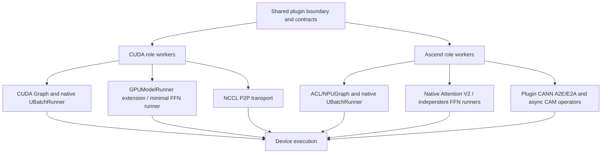

# Execution platforms

## Purpose and boundary

This document is the primary design for CUDA and NPU mechanisms: runtime
class strategy, device graphs, native DBO/ubatching, streams, forward-context
adaptation, profilers, native operators, packaging, and the tested runtime
matrix. [Attention](attention_runtime.md) and [FFN](ffn_runtime.md) retain role
lifecycle orchestration; [connector contracts](connector_contracts.md) retain
transport and topology semantics.

## Ownership and dependency direction

Platform mechanisms consume the common plugin boundary and upstream device
runtimes. They may be used by role, connector, and model modules but must not
introduce a CUDA-to-Ascend or Ascend-to-CUDA inheritance dependency.

## Runtime class strategy

CUDA and Ascend workers/Attention runners extend their matching native
runtime. FFN runners independently own connector-driven execution:

| Role | CUDA | Ascend |
| --- | --- | --- |
| Attention worker | `AFDAttentionWorker(Worker)` | `AFDNPUAttentionWorker(NPUWorker)` |
| Attention runner V2 | `AFDAttentionModelRunnerV2(GPUModelRunnerV2)` | `AFDNPUAttentionModelRunnerV2(NPUModelRunnerV2)` |
| FFN worker | `AFDFFNWorker(Worker)` | `AFDNPUFFNWorker(NPUWorker)` |
| FFN runner | Independent `GPUFFNModelRunner` | Independent `AFDNPUFFNModelRunner` (CAMP2P) or `AsyncNPUFFNModelRunner` (Async CAM) |

The NPU classes do not inherit CUDA AFD classes. Shared behavior is carried
by configuration, connector payloads, forward-context metadata, graph-policy
helpers, and small role helpers. This keeps CUDA Graph assumptions out of ACL
Graph classes and keeps vLLM-Ascend lifecycle behavior visible through its own
upstream types.

Runtime modules import their real device dependencies. CPU safety applies to
the top-level package, common configuration/validation, version checks, and
the graph policy helper; importing a CUDA or Ascend runtime module requires
the corresponding runtime stack.

## Platform mechanism map

| Mechanism | CUDA owner | NPU owner |
| --- | --- | --- |
| Worker/device lifecycle | vLLM `Worker` plus AFD role worker | vLLM-Ascend `NPUWorker` plus AFD role worker |
| Attention execution | native V2 `GPUModelRunner` extension | native V2 `NPUModelRunner` extension |
| FFN execution | independent connector-driven runner | independent synchronous/Async connector-driven runners |
| Graph policy/keying | `v1/worker/cuda_graph.py` | shared policy/keying plus ACL/NPUGraph integration |
| Native ubatching | native `UBatchRunner` with scoped AFD metadata preparation | `NPUUBatchRunner` adapting native child inputs, contexts and streams |
| Profiling | `compat/profiler.py` | `compat/npu/profiler.py` |
| Native operators | PyTorch/vLLM CUDA runtime used by NCCL P2P | plugin CANN A2E/E2A and routed-only async CAM ops |
| Build/packaging | no plugin CUDA extension | `setup.py`, `csrc/npu/**`, packaged `_cann_ops_custom` vendor tree |

## CUDA mechanisms

### Worker and device setup

Both CUDA workers delegate device and distributed setup to native
`Worker.init_device()`. During that synchronous construction window, they
temporarily replace the native V2 runner symbol with the AFD runner
and restore it in `finally`. Both roles require ModelRunnerV2. Attention
selects `AFDAttentionModelRunnerV2`; FFN selects the connector-driven
`GPUFFNModelRunner`. `torch.accelerator.empty_cache()` releases
startup allocations. Attention retains the matching upstream request,
KV-cache, sampling, and output behavior; FFN remains connector-driven.

### CUDA Graph policy

`validate_cuda_graph_mode()` resolves the shared AFD policy without importing
torch or vLLM at module import time. Current behavior is:

- `enforce_eager=true` disables graph execution;
- when graph execution is enabled, only vLLM `FULL_DECODE_ONLY` is accepted;
- Attention may use the upstream full-decode graph path;
- FFN owns a graph cache keyed by stage-indexed token-count metadata;
- native ubatching with graphs is accepted only for exactly two ubatches;
- other graph modes fail before runtime execution.

Attention treats DP metadata transfer as a control-plane side effect. For a
single-stage capture it sends the padded capture shape before entering formal
CUDA Graph capture. For an ubatched capture, the native `UBatchRunner`
preparation hook attaches AFD metadata to the exact stage slices and sends
their layout before the graph body.

CUDA ModelRunnerV2 supports exactly two native microbatches at Attention
DP1 or DP > 1 and reuses the native full-graph manager. Its Attention wrapper observes
each capture descriptor at input preparation and publishes warmup/capture
control outside the graph. Two-stage preparation installs metadata on both
children and sends the complete layout before eager execution or graph replay.
Single-stage full replay bypasses context creation, so an instance-scoped
`run_fullgraph` hook publishes its padded shape; two-stage replay reuses the
already-published layout. Temporary symbols and state are restored in `finally`.

FFN uses the Attention payload's warmup/capture flags. It creates a shared
CUDA graph memory pool, uses `connector.control_plane` to update the owning
connector state before `torch.cuda.graph(...)`, captures only
model/data-plane work, and stores the graph by `make_ffn_graph_key()`. A
future payload replays only when `is_graph_replaying=true` and its key matches;
otherwise FFN executes eagerly.

### CUDA native ubatching

Native `UBatchRunner` owns input slicing, stage contexts, execution threads,
streams, capture/replay, and output merge. AFD attaches stage-local metadata
and publishes the complete stage layout before native execution. Padded token
sizes drive graph coordination while unpadded lengths retain transfer semantics.
Scoped factory and dispatch adapters enable the native path at Attention DP1
as well as DP > 1. AFD accepts exactly two native ubatches.

Qwen3.5/3.6 GDN DBO is unsupported; native hybrid/multimodal DBO validation
applies. Qwen3 MoE DBO remains supported. Earlier Qwen GDN Graph + DBO and
six-cell recurrent-state/CUDA Graph parity results describe the removed adapter
and are historical evidence only. The DP1 path has H20
DeepSeek-V2-Lite DP1/TP2 Graph + DBO validation with 128 GSM8K samples
and live two-stage/full-replay assertions.

### CUDA profiling

Attention and FFN runners create separate optional `torch.profiler` instances.
They are controlled by `AFD_GPU_ATTENTION_PROFILER_*` and
`AFD_GPU_FFN_PROFILER_*` environment prefixes. Each runner advances its
profiler on execution and stops it during shutdown. `VLLM_TORCH_PROFILER_DIR`
is a fallback trace directory.

## NPU mechanisms

### NPU worker and runtime setup

NPU workers apply AFD-scoped vLLM-Ascend compatibility patches before
upstream construction. During device initialization they:

1. validate Ascend-specific feature combinations;
2. apply the non-sequence-parallel all-to-all backend correction when needed,
   including legacy explicit-worker launches;
3. validate the synchronous CAMP2P or eager Async CAM ModelRunnerV2 subset
   when V2 is selected;
4. call `NPUWorker._init_device()`;
5. initialize the vLLM workspace manager for one or two ubatches;
6. construct the matching V1 or V2 Attention runner, or the connector-driven
   FFN runner.

The all-to-all correction selects `flashinfer_all2allv` when sequence
parallelism is disabled. Automatic worker selection receives the matching
upstream default-worker rewrite during config normalization; the worker-side
correction remains as a fallback for legacy explicit-worker launches.

### NPU forward context

Attention extends the upstream vLLM-Ascend forward flow and installs AFD data
in `ForwardContext.additional_kwargs`. FFN uses
`ascend_forward_context()` to create the minimal upstream context needed for
connector-driven MoE compute, including token counts and ACL graph runtime
mode when applicable.

When ModelRunnerV2 is selected, `ascend_forward_context()` uses native
`set_forward_context()` plus vLLM-Ascend's MRV2 profile override. This places
Ascend-specific state, `model_instance`, and AFD metadata in
`additional_kwargs`, matching the proxy layout read by the V2 runtime. V1
continues to use `set_ascend_forward_context()`.

For native ubatching, `create_ascend_forward_context()` creates one context per
stage with stage attention/DP metadata, batch descriptor, and graph mode.
Sequence-parallel intermediate tensors and DP token counts are sliced or
reassembled to match the upstream Ascend layout.

### NPU native ubatching and DBO

`NPUUBatchRunner` extends native MRV2 `UBatchRunner`. Native code owns child
slicing, threads, handoff, capture/replay and output merge. AFD supplies Ascend
child metadata builders, NPU stream/context scopes, model-specific transport
coordinates and nested auxiliary output handling. The old NPU MRV1 runner,
wrapper, custom registry and request-boundary splitting implementation are
removed; there is no execution fallback.

`v1/worker/dbo.py` registers the model-side yield operation and dispatches to
the platform DBO implementation. Eager Async Attention uses native DBO at every
DP size, including DP1:
MRV2 reuses `NPUUBatchRunner` child preparation and output merge. Async children
are created with `dp_metadata=None` and establish local DP coordination scopes in their
threads. Before the next dispatch, a peer raw receive reclaims CAM's single
physical window; layout restoration, collectives and shared output stay with
the owner. DP1 has scoped factory/threshold adapters for upstream's DP1 early
returns. Native slicing owns request/token boundaries and distinguishes real
tokens from padding. FlashComm1
is Attention-local; without it, the CAM boundary shards replicated Attention
tokens and restores the FFN result with TP all-gather.

`NPUUBatchRunner` creates independent Ascend metadata builders per child and
keeps stable stage-owned block-table buffers for SFA/DSA builders that clear
padded rows in place. Plain MLA retains native persistent table views, because
its graph updater keeps the captured table address. Stage-owned RoPE buffers
isolate builders while preserving the addresses consumed by FULL graphs. Its scoped input adapter applies native request truncation to
Ascend's exact CPU sequence lengths as well as the native upper bounds. Native
NPU contexts update both the NPU stream and vLLM's thread-local stream cache.
A failed child aborts the bounded startup barrier and wakes its peer; a failed
CAM transfer still requires restarting the A/F group. These host-side wakeups
cannot cancel a kernel already polling a device communication window.

Synchronous MRV2 CAMP2P applies group-wise token padding before eager input
preparation, including graph fallback. Padding follows strided FFN receiver
groups and also keeps Attention TP peers aligned.

### ACL Graph and NPU Graph

NPU Attention follows the upstream ACL graph dispatcher while adding AFD
metadata and control-plane coordination. Native MRV2 owns single/two-stage
graph descriptors, warmup/capture, persistent outputs and replay. AFD retains
formal per-stage MLA registries by the complete native descriptor, including
LoRA specialization, and publishes one matching FFN control payload before
each warmup, capture or live replay.

For MLA DBO full graphs, each stage records its own upstream `GraphParams`.
`merge_mla_graph_params()` validates identical layer order and record counts,
requires the two stages to share one FIA workspace, and merges records in
layer-major/stage-minor order. During the upstream updater call, the merged
registry is exposed only through the active forward context under
`afd_mla_graph_params`; the compatibility resolver falls back to upstream
process-global state outside that scope.

This protocol belongs to the plain MLA backend alone. Upstream's sparse (SFA)
and compressor (DSA) backends implement `update_graph_params()` as a no-op and
register no FIA workspace, so those models, DeepSeek V4 among them, take the
generic two-stage path with no MLA registries.

With synchronous CAMP2P, the NPU V2 runner supports eager, `FULL`, and
`FULL_DECODE_ONLY`; Async CAM is eager-only. Like CUDA V2,
it publishes descriptor-matched warmup/capture control outside formal graph
capture and installs an instance-scoped pre-replay hook because native full
replay creates no `ForwardContext`. V2 does not use `AscendUBatchWrapper` and
uses native `NPUUBatchRunner` preparation, execution and merge for eager and
graph DBO. Plain MLA graph DBO requires `FULL_DECODE_ONLY`; SFA/DSA
accepted modes still require model-specific qualification. Native two-stage capture shares the ordinary descriptor's FIA
workspace; replay merges captured records with current metadata for Ascend
updates. Each child carries its actual stage ID for the opaque CAMP2P HCCL
group lookup. Async CAM enables eager native DBO at DP1; it has no separate
MoE stage pipeline. Async FFN FULL accepts eager Attention DBO; FFN stays
outside Attention's native DBO thread schedule.

The FFN runner owns a separate ACL graph cache keyed by stage token counts and
A/F topology. Warmup runs the eager FFN path. Formal capture updates connector
state through `connector.control_plane` before entering `torch.npu.graph(...)`,
so replay contains only model and data-plane operations. Replay additionally requires the control payload's
`is_graph_replaying=true`; an unknown key or eager payload executes eagerly. CAM async does not enter this path because validation
requires eager execution and `connector.control_plane` is `None`.

### Ascend native operators and packaging

`CAMP2pAFDConnector` uses plugin-owned A2E/E2A CANN operators. `setup.py`
builds the Ascend extension by default when `torch_npu`, Ascend environment
variables, or the default toolkit path identifies an Ascend environment.
`AFD_BUILD_ASCEND_OPS` explicitly enables or disables that selection, and
`AFD_SKIP_ACLNN_BUILD=1` skips the preceding ACLNN vendor build when the
artifacts already exist.

The build performs the CANN vendor build under `csrc/npu`, builds the PyTorch
CMake extension, and packages `_cann_ops_custom`. Loading remains lazy:
`ensure_cam_p2p_ops_available()` updates the vendor/library environment, imports
`afd_plugin._C_ascend`, and verifies `torch.ops.afd_ascend.a2e/e2a` only when
the connector initializes. The package can therefore be imported without the
NPU extension, but the CAMP2P data path cannot run without it.

`CAMAsyncAFDConnector` loads the same AFD extension and additionally requires
all four `torch.ops.afd_ascend.afd_async_*` operators. The 910C package uses
compact routed-only metadata; Attention owns shared experts and FFN owns
routed experts. The 950 package does not register these async operators.
See [the routed-only guide](../../npu/CAM_ASYNC_ROUTED_OPS.md) for metadata
and window lifetime contracts. Device validation remains necessary for each
target topology.

The routed-only operator host tiling reads `HCCL_BUFFSIZE` in MiB, sharing
the HCCL runtime's environment setting. When a domain overrides allocation
with `hccl_buffer_size`, set `HCCL_BUFFSIZE` to the same effective size.
The standalone harness sets both consistently. The host helper retains its
own default and cap; it does not query the domain's actual window size.

### NPU profiling

Attention and FFN use independent optional `torch_npu.profiler` instances,
controlled by `AFD_NPU_ATTENTION_PROFILER_*` and
`AFD_NPU_FFN_PROFILER_*`. The helper configures CPU/NPU activities, Level 2
experimental output, role-specific defaults, optional stacks/modules, and a
TensorBoard trace handler. Runners step the profiler on execution and stop it
during shutdown.

## Tested runtime matrix

This table records current validation gates and repository evidence. The
historical V1 rows are not current launch options or fallbacks. Evidence
does not expand the supported runtime contract.

| Platform/path | Execution | Ubatching | Routing/quantization limits | Evidence |
| --- | --- | --- | --- | --- |
| Historical CUDA V1 (removed) + `P2pNcclAFDConnector` | Eager or `FULL_DECODE_ONLY` CUDA Graph | Native DBO, exactly two ubatches | Registered CUDA model boundaries; Attention-side or FFN-side gate where the model supports it | DeepSeek-V2-Lite eager/graph/DBO accuracy E2E; model, graph, connector, and profiler unit tests |
| CUDA V2 + `P2pNcclAFDConnector` | Eager or `FULL_DECODE_ONLY` native V2 CUDA Graph | Exactly two native microbatches; Attention DP1 or DP > 1 | Model-specific gate placement; PP/CP, elastic EP, EPLB, SP MoE, and compile SP rejected; role ranks equal DP x TP | DeepSeek-V2-Lite eager/graph DP2 and TP2 E2E; H20 live two-stage execution and representative 300-question comparisons; numerical equivalence is not established. Qwen3.5/3.6 GDN DBO is unsupported; Qwen3 MoE DBO remains supported; DeepSeek-V2-Lite DP1/TP2 Graph + DBO passes 128 GSM8K samples and live two-stage/full-replay assertions |
| Historical Ascend V1 (removed) + `CAMP2pAFDConnector` | Eager or current ACL Graph path | Native DBO, exactly two ubatches | Common and connector-local `compute_gate_on_attention=false`; `connector_extra_config.quant_mode=0`; plugin CANN ops required | V2-Lite 2A2F graph 300-question comparison, 2A1F/2A2F functional checks, and Legacy DBO regressions; runtime, graph, ops, connector, and profiler unit tests |
| Ascend V2 + `CAMP2pAFDConnector` | Eager, `FULL`, or `FULL_DECODE_ONLY` native V2 ACL Graph | Eager or graph native DBO with two ubatches and Attention DP > 1; plain MLA graph DBO requires `FULL_DECODE_ONLY` | `compute_gate_on_attention=false`; PP/CP, elastic EP and EPLB rejected; model-specific SP policy; role ranks equal DP x TP | V2-Lite 2A2F FULL 300-question comparison and 2A1F eager/FULL_DECODE_ONLY/FULL functional checks; focused runner, context, validation, and device-contract unit tests |
| Ascend V2 + `CAMAsyncAFDConnector` | Eager Attention; independent FFN eager or narrow W4A8 FULL | Two native DBO microbatches on Attention, including DP1 and with FFN FULL; FFN stays outside the native DBO schedule; legacy split selector is ignored | Experimental async path; `async=true`; documented path uses common `compute_gate_on_attention=true`; prefill and decode context parallelism are unsupported; `connector_extra_config.dynamicQuant` is 0 or 1; plugin-owned async CAM ops required | Earlier V2-Lite and DSV4 layered comparisons retain their original scope; recorded eager/FULL fixture results use DBO-off; see the [Async FFN runtime](../../npu/ASYNC_FFN_RUNTIME.md) |

The Async CAM row also supports an MRV2 Attention runner for DeepSeek-V2/V3
MLA and DeepSeek-V4, with static EP, PP=PCP=DCP=1, and Attention-local SP.
Finegrained TP, explicit shared-expert DP configuration, and native
draft-model/MTP paths are excluded.
FFN remains connector-driven. The row's upgrade evidence retains its original
scope; MRV2 deployment settings are documented in the
[CAM async guide](../../npu/CAM_ASYNC_CONNECTOR_USER_GUIDE.md#modelrunnerv2-deployment).

DSV2/V3 Async CAM Attention with model SP selects Ascend shared-expert DP before
constructing the shared MLP. Each rank holds complete shared weights and computes
its local token rows. Attention TP/SP and routed-expert parallelism are unchanged.
Without model SP, the user's shared-expert DP setting is preserved. MRV2's
existing rejection of explicit shared-expert DP configuration is unchanged.

All rows target vLLM `0.30.0` (`ced6857a`); Ascend additionally targets
vLLM-Ascend `8d4409d6`. GPU integration evidence covers DeepSeek-V2-Lite
and Qwen3-30B-A3B on H20. The [NPU validation record](https://github.com/vllm-project/afd-plugin/pull/425#issuecomment-6063910923)
covers five representative configurations with the same first 300 GSM8K
questions: V2-Lite MRV1 graph, MRV2 FULL, ordinary Async CAM, and DSV4 Flash
W4A8 layered off/on. The [Legacy DBO repair](https://github.com/vllm-project/afd-plugin/pull/430#issuecomment-6063840311)
adds 2A1F/2A2F content regressions and a same-question 128-sample comparison;
it does not add a new 300-question result. These records do not establish all
model/topology support, numerical equivalence, performance, or clean device
shutdown. Synchronous DSV4 profiles remain smoke-only, with known incorrect
A5 concurrent answers; see their [E2E limits](../../../tests/e2e/README.md#dsv4-flash-sync-camp2p-concurrent-requests-local-4-or-16-npus).
GPU/NPU rank topology and connector resource rules remain owned by
[connector contracts](connector_contracts.md).

The repository does not record a canonical CUDA container or a released
vLLM-Ascend v0.30 container. The NPU integration targets source commit
`8d4409d6`; environment evidence is not an authoritative package tag.

## Failure and cleanup boundaries

Unsupported graph, ubatch, async, gate, or quantization combinations fail in
configuration/worker/runner initialization. Missing native operators fail at
connector initialization rather than package import. Device graph caches and
profilers are runner-owned; process groups and communication handles are
connector-owned; workspace/device teardown remains upstream-owned after the
AFD role releases its resources.

## Candidate invariants

The following RFC candidate is non-normative while this document is draft:

- `PLAT-INV-001`: CUDA and Ascend AFD classes do not inherit from each other;
  platform extensions use matching upstream classes, while
  `GPUFFNModelRunner` remains a plugin-owned minimal runner.

No cross-connector graph invariant is recorded until evidence is verified on
both platforms.

## Upstream relationship and validation requirements

CUDA behavior is developed against the pinned vLLM release. The recorded
Ascend source snapshot and environment are compatibility evidence, not a
released package/tag pin. Build,
graph, profiler, and native-op changes require the matching unit and hardware
E2E paths listed above.

## Limitations and open issues

The official vLLM-Ascend v0.30 tag/container and canonical CUDA/Ascend versus
GPU/NPU terminology are unresolved. This document uses CUDA/Ascend for backend
mechanisms and preserves GPU/NPU where it appears in public names, environment
variables, or test markers. See
[#129](https://github.com/JiusiServe/afd-plugin/issues/129).
