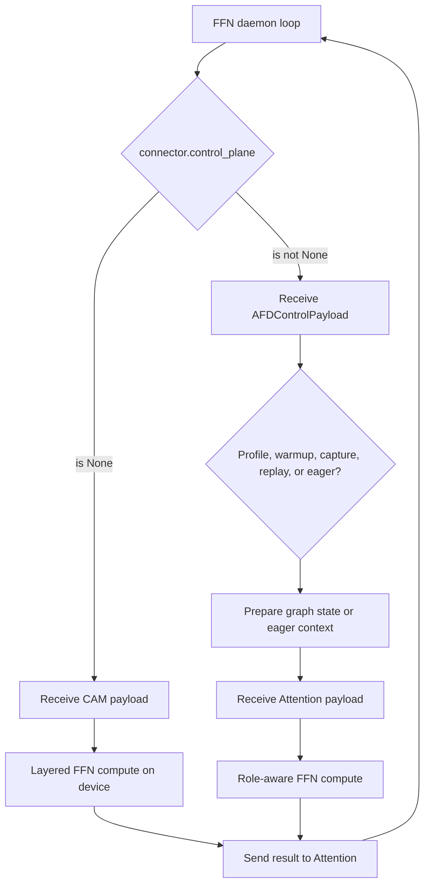

# FFN runtime

## Purpose and boundary

This document is the primary design for connector-driven FFN lifecycle
orchestration: daemon startup, empty KV-cache behavior, scheduler rejection,
compute handoff, error propagation, and shutdown. Transport semantics belong
to [connector contracts](connector_contracts.md); CUDA/Ascend graph, stream,
profiler, native-op, and build mechanisms belong to
[execution platforms](execution_platforms.md).

## Ownership and dependency direction

FFN consumes plugin configuration, connector transport, model-side compute,
platform mechanisms, and EngineCore compatibility. No shared module may depend
on the FFN worker or runner implementation.

Async CAM's connector owns HCCL, payload validation and initialization/cleanup
coordination. It selects a Push or Pull session at construction. Both inherit
the concrete `FFNExecutionSession` lifecycle defaults from `connectors/base.py`. Push owns
per-stage routing queues; Pull owns its single window, publish/combine, device
status and quiet/drain/stopped lifecycle. Pull takes Startup, topology and the
dimensions/capacity used for initialization and bounded drain; it does not
retain the connector. The FFN runner continues to own eager/FULL execution,
graph references and completion; the worker still owns the receiver thread.
The current Mega executor reads the same live window through the connector's
read-only `comm_args` property.

## Runtime selection

The traditional FFN is launched as a `vllm serve` process, and AFD config normalization selects
its role-specific worker when `worker_cls="auto"`. It does not serve requests.
Attention and FFN may be started in either order. Send API traffic only to
Attention.

DeepSeek-V4 Flash per-channel W4A8 also has a standalone F entry point,
`python -m afd_plugin.ffn_faas serve`, implementing independent-service
ownership under [RFC #391](https://github.com/vllm-project/afd-plugin/issues/391).
It composes `CAMAsyncAFDConnector` and `AsyncNPUFFNModelRunner` without creating
a vLLM Worker, upstream ModelRunner, EngineCore, scheduler or KV cache.
Attention retains its existing model, connector and DBO path. Configuration,
parameter loading and quantization remain vLLM/vLLM-Ascend dependencies.

The standalone Ascend CLI reuses vLLM engine argument definitions, parsing and
configuration construction. Existing AFD options remain in `additional_config`;
only host management and shutdown options are standalone-specific. The host
entry delegates parser creation to its selected platform, so CPU-only service
and host-loop imports remain independent of vLLM.

The CPU-only host `FFNModelRunner` accepts an `FFNBackend` factory, retains
the backend before preparation, and owns the receiving thread and failure
boundary. `FFNService` manages host status and stop requests. Platform options
and CAM runtime composition live under `ffn_faas/platforms/npu/`.

- `AscendFFNEnvironment` owns device initialization, F-only compute/EP groups
  and native post-warmup CPU affinity. These groups coexist with the separate
  A/F CAM group throughout execution.
- `CAMRoutedModel` manages parameter loading, local placement checks, storage
  accounting and cached-view lifetime. Startup selects a `RoutedModelAdapter`
  to provide checkpoint metadata and native owner construction. The backend
  uses the common resource without model-specific branching.
- Model-specific code follows `ffn_faas/platforms/ffn_model/<model>/<backend>/`.
  Under `deepseek_v4/npu/`, `v4_model.py` contains V4 checkpoint metadata and
  `V4ModelAdapter`. `v4_weights.py` contains the lazily imported native parameter
  owner. Native routed modules, expert-map managers and quantizers remain
  resident. The loader adapter delegates to the native V4 loader. Dependency
  upgrades must preserve its documented receiver and factory contracts.
- Platform settings enforce static CAM placement and reject EPLB, elastic EP
  and redundant experts. Retaining native expert state does not enable these
  algorithms.

`FFNBackend` is a runtime lifecycle interface. Its `execute_step()` delegates
communication, computation and Graph execution to the Async CAM
runtime. A shared cross-platform, cross-connector Step Loop and a pure
`compute(item)` backend are not implemented. The runtime consumes the existing
`LayeredFFNWeights` interface with W4A8 weights, without per-step model selection;
there is no
separate V4 execution runtime.

`attach_model` lends independently loaded parameters to the runtime. After
receiver exit and device completion, shutdown releases CAM/Graph resources,
then native compute groups, and finally the routed owner. Failed or pending
native work retains all owners until whole-pair process isolation. A host
`/stop` request cannot cancel an outstanding CAM DR.
See the [standalone service guide](../../npu/STANDALONE_FFN_SERVICE.md) for
supported configuration, launch and shutdown behavior.

| Platform | Worker | Model runner | Current connectors |
| --- | --- | --- | --- |
| CUDA | `afd_plugin.v1.worker.AFDFFNWorker` | `GPUFFNModelRunner` | `P2pNcclAFDConnector` |
| CUDA | `afd_plugin.v1.worker.AFDFFNWorker` | `GPUFFNRoutedExpertsModelRunner` | `DeepEPM2NAFDConnector` (any `AFDRoutedExpertsConnector`) |
| NPU | `afd_plugin.v1.worker.npu.AFDNPUFFNWorker` | `AFDNPUFFNModelRunner` (sync) or `AsyncNPUFFNModelRunner` | `CAMP2pAFDConnector`, `CAMAsyncAFDConnector` |

GPU and NPU FFN runners are independent, connector-driven owners. The CUDA
FFN worker selects `GPUFFNRoutedExpertsModelRunner` when the connector class
is an `AFDRoutedExpertsConnector`, and pins vLLM's MoE backend (`auto` becomes
`triton`; other backends are rejected) before the model is built. Ascend
selects the synchronous or Async runner in the FFN worker from the connector, with no MRV1
inheritance or fallback. Native model loading owns weight materialization and
quantization postprocessing. The runner explicitly initializes Ascend MC2
capacity/masks before construction, accounts for loaded memory, executes FFN
work, and owns its graphs, profiler and cleanup. Request/KV/sampling state
remains on Attention. Shared semantics live in configuration, metadata,
validation and small helpers.

CUDA launch shape:

```bash
VLLM_USE_V2_MODEL_RUNNER=1 vllm serve /path/to/model \
  --additional-config '{"afd":{"role":"ffn","connector":"P2pNcclAFDConnector","host":"127.0.0.1","port":1239,"num_attention_ranks":1,"num_ffn_ranks":1}}'
```

Ascend launch shape:

```bash
VLLM_PLUGINS=ascend,afd VLLM_USE_V2_MODEL_RUNNER=1 vllm serve /path/to/model \
  --additional-config '{"afd":{"role":"ffn","connector":"CAMP2pAFDConnector","host":"127.0.0.1","port":1239,"num_attention_ranks":1,"num_ffn_ranks":1}}'
```

## Initialization and empty KV cache

The common FFN initialization sequence is:

```text
vLLM worker construction
  -> validate AFD config, role, connector, and selected worker class
  -> validate the paired native V2 deployment contract
  -> initialize the matching upstream device worker
  -> construct the AFD FFN model runner
  -> derive the role-local AFD rank from DP/TP ranks when needed
  -> load the role-aware FFN model
  -> initialize an empty KV-cache surface
  -> initialize the connector
  -> start the background FFN loop
```

FFN does not own request KV blocks. Both workers return an empty KV-cache spec,
and both runners no-op KV-cache initialization. `compile_or_warm_up_model()`
returns `0.0`; warmup and graph capture, when supported, are driven later by
connector metadata. Because the FFN EngineCore skips that upstream warmup path,
the NPU worker performs vLLM-Ascend's CPU-binding step once immediately before
starting its connector daemon when `enable_cpu_binding` is enabled. The
EngineCore compatibility patch keeps FFN daemon mode out of upstream
scheduler/KV-cache startup assumptions and selects the daemon busy loop. See
[compatibility and patches](compatibility_and_patches.md).

The worker owns the daemon thread, shutdown event, and captured loop error.
The model runner owns the model, connector, profiler, and graph cache. The
connector owns transport/process-group resources.

## ModelRunnerV2 pairing

CUDA and Ascend require ModelRunnerV2 on both roles. FFN remains connector-driven and
does not adopt native V2 request state or scheduler-driven execution:

- CUDA overrides `Worker._make_model_runner()` to construct
  `GPUFFNRoutedExpertsModelRunner` for routed-experts connectors, otherwise
  `GPUFFNModelRunner`.
- Ascend constructs `AFDNPUFFNModelRunner` for CAMP2P or
  `AsyncNPUFFNModelRunner` for Async CAM. Both use the native MRV2
  forward-context shape and install Ascend state in `additional_kwargs`.
- Both workers run the same V2 topology and feature validator as the paired
  Attention role before constructing communication resources.

The V2 pair requires PP/PCP/DCP size 1, configured role ranks equal to DP x TP,
static EP on Attention, and a registered AFD model. The FFN role may enable
vLLM's expert-parallel load balancing (`--enable-eplb`): EPLB is FFN-only
because Attention holds no experts and no MoE routing, and FFN EPLB rejects
DBO/ubatching (see below). CUDA uses `P2pNcclAFDConnector` with
model-specific gate placement and supports two native microbatches with
Attention DP1 or DP > 1. See the
[runtime matrix](../../support.md#tested-runtime-matrix) for tested
configurations and known DeepSeek-V2-Lite DBO shutdown failures.
CUDA `DeepEPM2NAFDConnector` requires Attention-side gating, FFN TP 1, and
the same DBO setting on both roles; see the
[DeepEP M2N guide](../../gpu/DEEPEP_M2N_CONNECTOR_USER_GUIDE.md).
Ascend supports synchronous CAMP2P with FFN-side gating, or eager Async CAM
with Attention-side gating. CAMP2P supports eager and graph DBO with
Attention DP > 1 and matching two-stage FFN control metadata. Async CAM
supports eager Attention DBO at DP1 or DP > 1, and rejects native DBO flags on
FFN. Async FFN FULL accepts eager Attention DBO and continues to receive work
items independently of Attention's threads. These limits
describe the pair even though only Attention inherits a native V2 runner.

## Daemon step selection

The worker selects one of two FFN step paths from the optional
`connector.control_plane` interface:

| Selection state | Connectors | Worker behavior |
| --- | --- | --- |
| `control_plane is not None` | `P2pNcclAFDConnector`, `CAMP2pAFDConnector` | Call `control_plane.recv_dp_metadata_list()`, then profile, warm, capture, replay, or execute its stage map. |
| `control_plane is None` | `CAMAsyncAFDConnector` (NPU only) | Block directly on a connector work item; no separate DP-metadata control plane. |

The connector-driven path exists only on Ascend. GPU FFN supports
control-plane-driven connectors exclusively: `GPUFFNModelRunner` asserts
`connector.control_plane is not None` at construction, and the GPU daemon loop
raises `NotImplementedError` if a connector without a control plane is ever
installed.



### Control-plane-driven loop

```text
FFN initialize_from_config(...)
  -> initialize empty KV-cache surface
  -> initialize connector
  -> start daemon thread

daemon thread:
  -> connector.control_plane.recv_dp_metadata_list()
  -> inspect stage metadata plus profile/warmup/capture flags
  -> capture/warm matching graph, or execute FFN forward
  -> synchronize the current accelerator
  -> repeat
```

### Connector-driven loop

The Ascend worker checks `connector.control_plane`. When it is `None`, as for
CAM async, the worker calls `execute_connector_driven_step(shutdown_requested)`
instead of a control-plane receive. The runner asks the execution session once
per step whether to keep serving, so Pull adds no extra Store round trip to the
loop. For each layer, the runner:

1. receives a capacity-sized payload and its original CAM metadata through
   `connector.recv_attn_output()`;
2. passes activations, dynamic scales, expert counts and the device layer ID
   to `AsyncCAMLayeredExecutor`;
3. returns the routed output and original context with
   `connector.send_ffn_output()`.

Async eager does not use the synchronous DP-metadata graph cache. Its FULL
mode captures a complete original DR/FFN/CS transaction with device-side layer
selection. The independent Async runner owns one graph and stable resources;
see [Async FFN runtime](../npu/async_ffn_runtime.md) for startup, supported
W4A8/W8A8 configurations and the original receiver's process-cleanup boundary.

DeepSeek-V4 W4A8 and W8A8 use layered GMM for both eager and FULL. Incompatible
weights fail startup rather than selecting another FFN path. Worker-level
synchronization remains after a work-item group. The `swiglu_limit` behavior
and validation scope are documented in the
[CAM async guide](../../npu/CAM_ASYNC_CONNECTOR_USER_GUIDE.md#w4a8-and-w8a8-layered-gmm).

## Control-plane-driven forward

The current runner contract for one control payload is:

1. Update connector state from the stage-indexed DP metadata.
2. Build the minimal vLLM forward context required by model-side MoE compute.
3. Iterate model layers and sorted stage ids.
4. Receive an `AFDA2FTransferPayload` for the current layer/stage, which
   carries the hidden states plus an `AFDTransferContext` (transfer metadata
   and the backend `AFDTransferState`).
5. Install stage DP metadata and transfer metadata at
   `ForwardContext.additional_kwargs["afd_metadata"]`.
6. Set vLLM's current MoE layer index when the upstream context exposes the
   layer list.
7. Compute FFN output and send it to Attention with the same layer/stage
   identity, passing the same `AFDTransferContext` back into
   `send_ffn_output()` so the connector can reuse its receive-time state.

On Ascend, `is_profile` is also forwarded into the minimal forward context so
vLLM-Ascend preserves its balanced dummy-MoE and communication state during
the split memory-profile run. CUDA carries the field in the common envelope
but does not need a separate FFN profile-context branch.

On CUDA, `GPUFFNModelRunner` is a plugin-owned minimal runner. It invokes
`model.compute_ffn_output(hidden_states, layer_idx)` when provided and
otherwise passes hidden states through; production AFD model paths are
expected to provide the compute method. On Ascend, `AFDNPUFFNModelRunner`
directly calls the role-aware model. The control-plane-driven path (CAMP2P)
does not thread per-transfer payload fields through `compute_ffn_output`:
CAMP2P's `CAMP2PTransferState` (operator sizes, the A2E-returned
`atten_batch_size`, `x_active_mask`, and HCCL endpoint name) rides on
`AFDTransferContext.states` and the forward context between the receive and
send phases.

Ascend translates AFD-level token counts to the DP-level token-count vector
expected by the upstream forward context. When TP expands Attention rank
counts beyond DP metadata width, token counts are replicated per TP rank and
then aggregated for each FFN rank.

### Routed-experts forward

`GPUFFNRoutedExpertsModelRunner` serves connectors that deliver routed
(token, local expert) rows (DeepEP M2N). Routing runs on Attention, so the
runner skips the forward-context and DP metadata setup above. After the native
loader runs, it reads each MoE layer's local experts from vLLM's
`RoutedExperts` (`FFNLocalExperts`, `FusedMoE` layout) and passes them, with the
MoE layer indices, to the connector's collective `init_afd_connector()`. For
each MoE layer and stage, in Attention's order, it receives the routed rows,
runs `connector.run_experts()`, and sends the weighted rows back; at the end
of the step it calls `connector.synchronize_lanes()`. vLLM's MoE forward never
runs on this runner. Dense (non-MoE) layers and shared experts have no owner
on this path, so the model adapters reject them.

With EPLB the routed runner replaces the base EPLB step: nothing on this
FFN routes tokens, so no load is recorded on it. Its `eplb_step` delegates
to the connector's FFN EPLB driver
(`afd_plugin/connectors/gpu/deepep_m2n/eplb.py`), which counts every
connector step, and at each rearrangement boundary collects the
Attention-recorded load window over the connector's bootstrap group, runs
`EplbState.rearrange` directly and broadcasts the committed maps; Attention
adopts them before it routes the next step. The Attention side of that
module owns the recorder: it maps logical top-k ids to physical slots in the
model proxy's routing path and records load with stable-address tensors
CUDA graphs capture. With `log_balancedness` the connector logs EPLB's loss
for the deployed placement every `log_balancedness_interval` steps (see
below).

## FFN-side EPLB

The FFN role can enable vLLM's expert-parallel load balancing
(`--enable-eplb` plus `--eplb-config`). Support is decided in one place:
`afd_plugin/eplb/capability.py` keys the request on router location,
connector and role, so a combination without a backend raises
`EplbUnsupportedError` (a `RuntimeError`) instead of failing late. The
decision table currently enables the GPU rows only: FFN-local EPLB on
`P2pNcclAFDConnector` and on `DeepEPM2NAFDConnector` (which also enables
Attention-side logical-to-physical mapping).

`GPUFFNModelRunner` composes the platform-neutral `FFNEplbLifecycle`
(`afd_plugin/eplb/lifecycle.py`) with the GPU `EplbBackend` implementation
(`afd_plugin/eplb/gpu.py`, a wrapper over the native `EPLBController`), and
follows the upstream `GPUModelRunner` wiring:

- `load_model` calls `prepare_load`, registers the loaded model through
  `maybe_register_model` (the AFD FFN model inherits the native
  `MixtureOfExperts` protocol, so the native `DeepseekV2MoE` layers receive
  `EplbLayerState` maps and buffers), and starts the async transfer loop.
- Every connector step prepares the router's unpadded token count and then
  steps the EPLB state: eager steps and graph replays are real steps that
  record expert load; warmup and graph-capture steps are dummy steps that
  keep every FFN rank's rearrangement counter in lockstep.
- Rearrangement runs entirely inside the native `EplbState`: load windows
  are all-reduced across the FFN EP group, new maps are committed in place
  (CUDA-graph compatible), and expert weights move over the EPLB
  communicator (auto-selected: nixl, falling back to torch_gloo).

With `log_balancedness` in `--eplb-config`, vLLM logs its balancedness
stats from `EplbState.step`, and the runner additionally logs the committed
placement — which logical experts each FFN EP rank holds, per MoE layer, and
the replicated ones — whenever a step commits a rearrangement (`eplb_step`
snapshots the map only on steps where the counter boundary or a pending
async transfer can commit, so ordinary steps stay sync-free). The same
placement log runs on the DeepEP M2N path (see the routed-experts note
above); the formatters live in `afd_plugin/distributed/eplb.py`.

The unpadded token count is the step's total real Attention tokens
(`real_attention_token_total` in `ffn_metadata.py`), excluding the
placeholder rows idle Attention peers transfer. Every FFN rank's router
view covers those tokens, either through TP-replicated delivery or through
the MoE-level all-gather, so the count matches the rows the router's
map-and-record kernel processes.

The lifecycle owns no device tensors: it forwards `prepare_forward` and
`step` to the backend on every connector step. Backends are platform
specific (GPU: `EPLBController`/`EplbState`, NCCL or the configured EPLB
communicator; NPU will wrap the vLLM-Ascend V2 stack) so that vLLM and
vLLM-Ascend version bumps stay independent.

Limits: EPLB is rejected on the Attention role (its CUDA remote-expert
shells hold no experts), and FFN EPLB rejects DBO/ubatching because the
FFN daemon loop never installs vLLM's DBO thread context, so the record
kernel could not select the per-ubatch token count. EPLB recipes live under
`recipe/gpu/P2pNcclAFDConnector/deepseek_v2_lite/prefill_decode_colocation/`.

### Loss logging on DeepEP M2N

On the M2N path no `EplbState.step` runs, so vLLM's balancedness line never
appears. `DeepEPM2NFFNEplb` therefore logs EPLB's own objective itself, and it
logs it at two cadences (both opt-in through `log_balancedness`):

- **every `log_balancedness_interval` steps**, the deployed map's loss on the
  Attention ranks' load window;
- **at each rearrangement**, the loss of the map being replaced and of the map
  just committed, on the same window.

Both use `eplb_map_loss`, i.e. the quantity `DefaultEplbPolicy` optimises: a
logical expert's window load divided evenly over the replicas the candidate map
gives it, packed into ranks and reduced to the per-layer mean/max ratio vLLM
uses. A per-step figure was deliberately not kept: it measures *realised* load,
which the policy never sees and which moves with the batch rather than with the
placement.

```
AFD FFN EPLB step 1400: loss=0.9312 over 1000 steps (avg_tokens=..., max_tokens=...), steps until the next rearrangement: 1600
AFD FFN EPLB loss: before=0.9421, after=0.9709, gain=+3.06%
```

Mechanics:

- The trigger is the same rearrangement counter that paces the boundaries, so
  both roles log at the same step: the FFN after its forward, Attention when it
  steps the finished transaction, exactly like the boundary exchange.
- Attention ranks aggregate their own load window into logical experts
  (`logical_load_from_window`, the only load the policy ever reads) and the FFN
  ranks contribute zeros; the connector's bootstrap group reduces the sum to FFN
  world rank 0, which scores the deployed map and logs it. A window that
  recorded nothing (warmup, graph capture) logs nothing.
- `over N steps` is the number of recorded steps in the window, which is
  `min(steps since the last rearrangement, window_size)`: the recorder clears
  its window when Attention adopts a new map, because slot identities change
  with the placement and load recorded under the old map cannot be read through
  the new one. A window is fully refreshed before the next boundary whenever
  `window_size <= step_interval`, so rearrangements are unaffected.
- Each logged step costs a host sync on every rank, which is why the interval
  exists; a rearrangement boundary is unaffected and still runs the map exchange
  only.
- Because both figures of the rearrangement line come from one window, `gain` is
  the policy's own improvement rather than workload drift. On CUDA the proposal
  commits unconditionally, so a negative `gain` is visible rather than gated.

## Role-aware model loading

The FFN process uses vLLM's model loader, while plugin-owned model integration
constructs FFN MLP/expert components plus shared components needed by the
upstream lifecycle, without Attention modules. FFN runners do not sample
tokens. GPU LoRA mutation methods return unsupported/no-op results; the NPU
runner rejects sampling explicitly.

Detailed model construction and weight ownership remain in
[model integration](model_integration.md).

## Graph dispatch contract

For connectors with a control plane, the graph cache key is derived from each
stage's token counts. Ascend also includes A/F topology when it must aggregate
Attention counts to FFN counts. The shared dispatch states are eager, warmup,
capture, and replay:

- warmup runs FFN compute after applying control state;
- capture applies connector control state before entering the formal device
  graph so control-plane work is not replayed;
- replay requires `is_graph_replaying=true` and an existing matching key;
- a missing graph or an eager Attention payload runs eagerly.

The Attention control payload is the source of warmup/capture flags. Device
graph objects, pools, supported modes, and exact cache behavior are specified
by [execution platforms](execution_platforms.md).

## Failure propagation and shutdown

`execute_model()` on either worker raises immediately if the native scheduler
tries to drive FFN work. The runner also rejects a normal execution call that
lacks its connector metadata/work item.

The daemon catches failures, stores the original exception, logs it, and makes
the error visible through `raise_ffn_loop_error_if_any()`. Re-entering startup
or completing shutdown therefore surfaces an earlier background failure.

CUDA shutdown ordering is:

```text
signal daemon event and close the control plane
  -> join daemon thread with a bounded timeout
  -> surface stored loop error
  -> after the thread has exited, delegate worker/runner shutdown upstream
  -> runner stops profiler, releases its GPU state and closes the connector
```

Connector receive calls may be blocking. The GPU control plane aborts its
owned metadata process group to unblock the receiver before joining it. If the
thread does not exit, native resources are not released underneath it. The
connector then releases its remaining communication resources during runner
shutdown. An earlier daemon failure is still surfaced after the join. Ascend
uses its own connector close or asynchronous drain path before joining the
daemon; see the [Async FFN runtime](../npu/async_ffn_runtime.md).

## Candidate invariants

The following RFC candidate remains non-normative while this document is
draft:

- `ROLE-INV-001` (FFN part): FFN remains connector-driven and rejects
  scheduler execution.

The optional control-plane and connector work-item surfaces, and the current
`AFDTransferContext`/`AFDTransferState` transfer payload shape, are not stable
contracts.

## Upstream relationship and validation requirements

Changes must be compared with the pinned vLLM worker and EngineCore behavior
and, for Ascend, with the tested runtime evidence. Run the FFN runner,
EngineCore patch, NPU runtime, and serving tests listed in the metadata.
Control-plane selection or work-item changes also require connector and CAM
async model E2E coverage.

## Limitations and open issues

Platform-specific execution limits and validation evidence are centralized in
[support matrix](../../support.md#tested-runtime-matrix).

Issue [#107](https://github.com/JiusiServe/afd-plugin/issues/107) completed the
optional control-plane split. Connector metadata ownership, transfer state
separation, and the public shape of the connector work-item interface remain
open in [#88](https://github.com/JiusiServe/afd-plugin/issues/88) and
[#105](https://github.com/JiusiServe/afd-plugin/issues/105).
