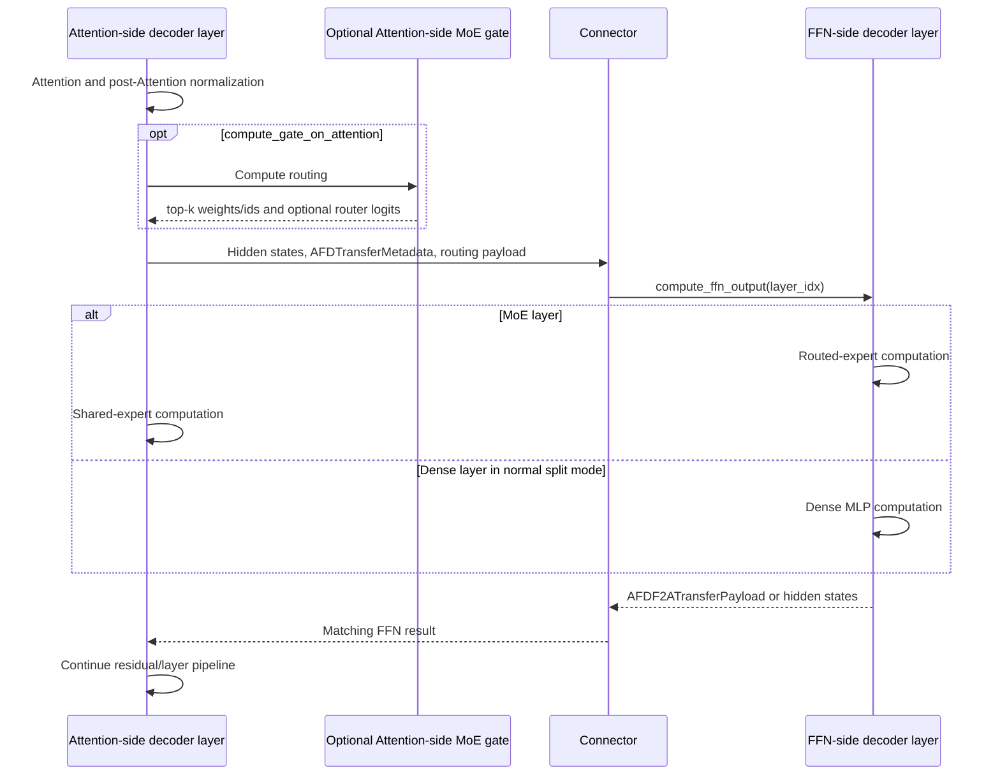

# Model integration

## Purpose and boundary

This document owns model registration, role-aware construction and weight
loading, forward-context metadata access, and model-side AFD execution. Worker
lifecycle and connector transport implementations remain outside this module.

## Ownership and dependency direction

Model integration consumes plugin configuration, connector payload contracts,
and platform mechanisms. It must not reach into concrete worker instances or
make a backend-specific worker class the shared model API.

## Implementation evidence

| Area | Source | Focused validation |
| --- | --- | --- |
| Registration map | [`afd_plugin/__init__.py`](../../../afd_plugin/__init__.py) | [`test_package.py`](../../../tests/unit/package/test_package.py) |
| Role-aware model and weight loading | [`deepseek_v2.py`](../../../afd_plugin/model_executor/models/deepseek_v2.py) | [`test_forward_context.py`](../../../tests/unit/model_executor/models/test_forward_context.py), model and accuracy E2E suites |
| DeepSeek V4 CUDA role boundary | [`deepseek_v4.py`](../../../afd_plugin/model_executor/models/deepseek_v4.py) | [`test_deepseek_v4_construction.py`](../../../tests/unit/model_executor/models/test_deepseek_v4_construction.py), [`test_deepseek_v4_proxy.py`](../../../tests/unit/model_executor/models/test_deepseek_v4_proxy.py), [`test_deepseek_v4_weight_policy.py`](../../../tests/unit/model_executor/models/test_deepseek_v4_weight_policy.py) |
| DeepSeek V4 Ascend Hash-id boundary | [`npu/deepseek_v4.py`](../../../afd_plugin/model_executor/models/npu/deepseek_v4.py), [`npu/deepseek_v4_attention_gate.py`](../../../afd_plugin/model_executor/models/npu/deepseek_v4_attention_gate.py) | [`test_deepseek_v4_hash_ids.py`](../../../tests/unit/model_executor/test_deepseek_v4_hash_ids.py), [`test_deepseek_v4_npu_weight_roles.py`](../../../tests/unit/model_executor/test_deepseek_v4_npu_weight_roles.py), ids-mode cases in [`test_camp2p_token_ids.py`](../../../tests/unit/connectors/test_camp2p_token_ids.py) |
| Qwen3 MoE role-aware model and weight loading | [`qwen3_moe.py`](../../../afd_plugin/model_executor/models/qwen3_moe.py) | [`test_qwen3_moe_construction.py`](../../../tests/unit/model_executor/models/test_qwen3_moe_construction.py), [`test_qwen3_moe_weight_policy.py`](../../../tests/unit/model_executor/models/test_qwen3_moe_weight_policy.py) |
| FastAFD dispatch/combine custom ops | [`fastafd_moe.py`](../../../afd_plugin/model_executor/models/fastafd_moe.py) | [`test_fastafd_moe.py`](../../../tests/unit/model_executor/models/test_fastafd_moe.py), [`test_qwen3_moe_construction.py`](../../../tests/unit/model_executor/models/test_qwen3_moe_construction.py), [`test_qwen3_5_contract.py`](../../../tests/unit/model_executor/models/test_qwen3_5_contract.py) |
| CUDA remote-experts boundary | [`deepseek_v2.py`](../../../afd_plugin/model_executor/models/deepseek_v2.py), [`gpu/p2p.py`](../../../afd_plugin/connectors/gpu/p2p.py) | [`test_p2p_experts_contract.py`](../../../tests/unit/connectors/test_p2p_experts_contract.py), [`test_deepseek_v2_proxy.py`](../../../tests/unit/model_executor/models/test_deepseek_v2_proxy.py) |
| Forward-context adapter | [`forward_context.py`](../../../afd_plugin/model_executor/models/forward_context.py) | [`test_forward_context.py`](../../../tests/unit/model_executor/models/test_forward_context.py) |
| NPU Async CAM native DBO handoff | [`npu/async_cam_dbo.py`](../../../afd_plugin/model_executor/models/npu/async_cam_dbo.py), [`npu/ubatch_runner.py`](../../../afd_plugin/v1/worker/npu/ubatch_runner.py) | [`test_async_cam_dbo.py`](../../../tests/unit/model_executor/test_async_cam_dbo.py), [`test_npu_model_runner_v2.py`](../../../tests/unit/v1/worker/test_npu_model_runner_v2.py) |
| Ascend Attention-side gate | [`npu/deepseek_v2_attention_gate.py`](../../../afd_plugin/model_executor/models/npu/deepseek_v2_attention_gate.py) | Attention-gate unit cases in [`test_forward_context.py`](../../../tests/unit/model_executor/models/test_forward_context.py) |
| Ascend CAM dispatch layout | [`npu/async_cam_layout.py`](../../../afd_plugin/model_executor/models/npu/async_cam_layout.py) | [`test_async_cam_layout.py`](../../../tests/unit/model_executor/test_async_cam_layout.py) |
| DeepSeek Ascend stage metadata ownership | [`npu/deepseek_attention_metadata.py`](../../../afd_plugin/model_executor/models/npu/deepseek_attention_metadata.py) | [`test_deepseek_attention_metadata.py`](../../../tests/unit/model_executor/test_deepseek_attention_metadata.py) |
| Ascend CAM orchestration | [`npu/deepseek_v2_async_cam_forward.py`](../../../afd_plugin/model_executor/models/npu/deepseek_v2_async_cam_forward.py) | Async/ubatch unit cases and [`test_async_cam_npu.py`](../../../tests/e2e/models/deepseek_v2_lite/test_async_cam_npu.py) |

## Model registration

`register_afd()` leaves vLLM's native architecture lookups unchanged and
registers lazy AFD wrapper paths under `AFD`-prefixed aliases.

| Checkpoint architecture | AFD registry alias | Registered AFD class |
| --- | --- | --- |
| `DeepseekForCausalLM` | `AFDDeepseekForCausalLM` | `AFDDeepseekForCausalLM` |
| `DeepseekV2ForCausalLM` | `AFDDeepseekV2ForCausalLM` | `AFDDeepseekV2ForCausalLM` |
| `DeepseekV3ForCausalLM` | `AFDDeepseekV3ForCausalLM` | `AFDDeepseekV3ForCausalLM` |
| `DeepseekV32ForCausalLM` | `AFDDeepseekV32ForCausalLM` | `AFDDeepseekV3ForCausalLM` |
| `DeepseekV4ForCausalLM` | `AFDDeepseekV4ForCausalLM` | `AFDDeepseekV4ForCausalLM` |
| `GlmMoeDsaForCausalLM` | `AFDGlmMoeDsaForCausalLM` | `AFDGlmMoeDsaForCausalLM` |
| `Qwen3MoeForCausalLM` | `AFDQwen3MoeForCausalLM` | `AFDQwen3MoeForCausalLM` |
| `Qwen3_5MoeForConditionalGeneration` | `AFDQwen3_5MoeForConditionalGeneration` | `AFDQwen3_5MoeForConditionalGeneration` |

Only AFD workers switch their worker-local model configuration to the matching
alias before constructing the AFD model runner. Non-AFD workers keep the
checkpoint architecture and resolve to vLLM's native model class.

The DeepSeek, DeepSeek V2/V3/V3.2, and GLM aliases share the DeepSeek
V2-derived implementation. DeepSeek V4, Qwen3 MoE, and Qwen3.5/3.6 each have a
separate wrapper around their matching native architecture. These aliases
express known compatible architecture families; they do not make any wrapper
a generic MoE model API.

## Role-aware module construction

Non-AFD workers use the pinned vLLM model implementation directly. When an AFD
worker selects an AFD alias, `AFDDeepseekV2DecoderLayer` constructs only the
components needed for the selected role while retaining layer normalization
needed by the split execution.

| Layer/component | Attention role | FFN role |
| --- | --- | --- |
| Attention module and KV-facing computation | Constructed and executed. | Not constructed. |
| MoE with `compute_gate_on_attention=false` | CUDA constructs the native MoE shell with a parameter-free internal-router experts proxy; NPU sends after post-Attention normalization. | Native gate and experts are constructed and executed from connector input. |
| MoE with `compute_gate_on_attention=true` | CUDA keeps the native gate and uses an external-router experts proxy; NPU uses its Attention-side gate helper. | Expert MLP is constructed and consumes transferred router logits or routed payloads without rerunning the gate. |
| Dense MLP, normal mode | Not constructed; output is sent after post-Attention normalization. | Constructed and executed from connector input. |
| Dense MLP with `compute_gate_on_attention=true` | Constructed and executed locally because there is no routed MoE handoff. | Not constructed and a dense-layer FFN compute request is rejected. |
| Embedding, final norm, pipeline placeholders | Created according to the pinned pipeline-rank rules. | Same wrapper lifecycle rules; only role-required parameters are loaded. |

CUDA MoE always splits at the remote-experts boundary while preserving native
`DeepseekV2MoE.forward`. With gate-on-FFN, the proxy asks FFN to run its native
internal-router MoE. With gate-on-Attention, Attention runs the native gate and
FFN executes its external-router experts path. CUDA Attention-side remote
experts currently reject EPLB. The NPU gate helper supports unquantized and
Ascend W8A8 MoE expert computation; unsupported devices or quantization fail
explicitly.

The full AFD model remains decorated with vLLM's compile support. Backend-only
helpers are imported inside the NPU path so CUDA model import does not require
vLLM-Ascend.

### DeepSeek V4 CUDA boundary

`AFDDeepseekV4ForCausalLM` wraps vLLM's NVIDIA DeepSeek V4 implementation and
splits immediately around each decoder FFN. Attention owns Attention, all mHC
residual-stream state and normalization, embeddings/finalization, auxiliary
CUDA streams, and sparse-index buffers. It sends only the normalized
two-dimensional FFN activation plus token-aligned `input_ids` through a
parameter-free `RemoteDeepseekV4FFN`. FFN owns the complete native
`DeepseekV4MoE`, including its hash router, and returns the FFN activation.

Role-aware weight filtering keeps layer `.ffn` parameters on FFN and all
other layer-local and mHC head parameters on Attention; common non-layer paths
remain available to both roles for the native loader lifecycle. The adapter is
CUDA-only and requires synchronous `P2pNcclAFDConnector`,
`compute_gate_on_attention=false`, and pipeline-parallel size 1. It rejects
sequence-parallel MoE, EPLB, and the `deep_gemm_mega_moe` backend. The P2P
connector validates one-dimensional `torch.int32` input IDs and preallocates
their receive buffers for graph execution. This boundary currently has
focused unit coverage but no repository model or accuracy E2E case.

### DeepSeek V4 Ascend boundary

[`npu/deepseek_v4.py`](../../../afd_plugin/model_executor/models/npu/deepseek_v4.py)
wraps the native Ascend model independently of the CUDA adapter. Attention
owns attention, mHC, normalization and finalization. Synchronous CAMP2P sends
normalized hidden states and Hash-layer token IDs to FFN, which owns the
native gate and MoE. Async CAM keeps the Hash/top-k router and shared experts
on Attention and sends only routed-expert work; `dynamicQuant=1` is required.

Shared-expert layout is model-specific. DeepSeek-V2/V3 Async CAM forces
replicated shared weights when effective model SP is enabled. DeepSeek-V4
instead uses `AFDDeepseekV4SharedExperts` to preserve the native policy:
TP-sharded weights need all-gather/reduce-scatter around SP computation, or
all-reduce without SP; replicated shared weights compute local SP tokens,
or split/gather replicated input tokens without SP. The W8A8 fused arithmetic
adapter preserves the shared MLP's clamp and activation parameters. This is
separate from the optional routed W4A8 layered executor's unresolved nonzero
`swiglu_limit` behavior.

The synchronous DSV4 E2E profiles check concurrent serving but disable answer
checking; the A5 profile records incorrect concurrent answers. Async DSV4 has
an exact-answer smoke case; current native DBO still requires model accuracy
qualification. See
[E2E testing](e2e_testing.md) and the [layered guide](../../npu/CAM_ASYNC_CONNECTOR_USER_GUIDE.md#w4a8-layered-gmm-experimental-disabled-by-default).

### Qwen3 MoE CUDA boundary

`AFDQwen3MoeModel` uses the native `decoder_layer_type` injection hook. The
Attention role constructs native Qwen Attention and normalization modules and
uses a parameter-free `RemoteFFNProxy`; the FFN role constructs the complete
native dense MLP or `Qwen3MoeSparseMoeBlock`. Native forward order, FusedMoE,
packed parameter mapping, quantization paths, and weight loading remain owned
by vLLM. Checkpoint weights are filtered once by layer-stage path before the
native loader consumes them.

With `FastAFDAFDConnector` Attention also owns the gate
(`AFDQwen3MoeAttentionRoutedMoE`): it computes native softmax top-k with
`norm_topk_prob` renormalization and hands the routed experts to the
connector through the shared `afd_fastafd_dispatch` and `afd_fastafd_combine`
custom ops in `fastafd_moe.py`. The copy that dispatch returns feeds combine,
so `torch.compile` keeps the two kernels in order. FFN loads its routed experts
through `FastAFDFFNModelRunner` and does not build the model. Every layer must
be a MoE layer, and the checkpoint must not have shared experts. DBO is
rejected with this connector: the expert kernel serves every layer's lanes in
order, which needs the two microbatches to alternate per layer.

This path is CUDA-only. It requires `compute_gate_on_attention=false` with
`P2pNcclAFDConnector` and `true` with `FastAFDAFDConnector`. It fails during
construction for sequence-parallel MoE, EPLB, pipeline parallelism,
speculative decoding, LoRA, or NPU.

### Qwen3.5/3.6 MoE CUDA boundary

`AFDQwen3_5MoeForConditionalGeneration` is a distinct wrapper around vLLM's
native hybrid Qwen3.5/3.6 architecture. Attention owns embeddings, norms, and
linear/full-attention state, then sends hidden states only. FFN owns the native
gate, routed experts, shared expert, and shared-expert gate.

With `FastAFDAFDConnector` the split moves: Attention also owns the gate, the
shared expert and the shared-expert gate (`AFDQwen3_5AttentionRoutedMoE`),
computes native softmax top-k with `norm_topk_prob` renormalization, and hands
only routed experts to the connector: `dispatch` sends them, the shared expert
runs while the FFN ranks compute, and `combine` returns the routed output that
is added to it. Two custom ops (`afd_fastafd_dispatch`, `afd_fastafd_combine`)
(shared with Qwen3 MoE, in `fastafd_moe.py`) carry data dependencies through
the shared expert, so `torch.compile` keeps it
between the two kernels while the shared expert itself stays compiled. FFN loads the routed experts itself through
`FastAFDFFNModelRunner`. The routed experts then run in the kernel's per-32
UE8M0 FP8 format (activations and the SwiGLU intermediate are quantized), so
outputs differ from the native block-FP8 path at the level of that format.

This path is CUDA-only, text-only, and requires `--language-model-only`,
`compute_gate_on_attention=false` (P2P) or `true` (FastAFD), and
`pipeline_parallel_size=1`. It rejects
multimodal execution, sequence-parallel MoE, EPLB, speculative decoding, and
LoRA before language-model construction; NPU model-config resolution fails
before model loading. GDN DBO is unsupported under native hybrid/multimodal
DBO validation; ordinary eager and graph execution remain supported. Earlier
H20 Graph + DBO and recurrent-state/CUDA Graph parity checks describe the
removed adapter and do not qualify the current implementation. The current
2A1F suite keeps static EP and PP1. Attention-side router transport, async
communication, multi-node, quantization, and performance remain outside the
validated scope.

## Forward-context contract

The runner installs `AFDForwardContextMetadata` in
`ForwardContext.additional_kwargs["afd_metadata"]`. Model code reads only that
key through `get_afd_metadata_from_forward_context()`; it does not inspect an
ad-hoc `ForwardContext.afd_metadata` attribute. The current metadata supplies
stage/request/token slicing, stage count, optional transaction ID, and a live
connector reference.

Native forward-context creation can bypass an AFD model-runner call site:
Ascend V1 dummy runs do so, while V2 creates its context inside native
`execute_model()`. During those scopes, `use_afd_metadata_provider()`
temporarily wraps `vllm.forward_context.create_forward_context`, lets the
runner install the same `additional_kwargs` entry, and restores the original
function in `finally`. This is a scoped compatibility adapter, not a permanent
global provider.

Async CAM reuses native DBO child slices, attention metadata and execution. The generic adapter
installs `afd_metadata` on the native child context; CAM transfer metadata and
TP/SP layout conversion remain necessary for the communication boundary in
`models/npu/async_cam_layout.py`. The single-window receive hook lives in
`models/npu/async_cam_dbo.py`. Metadata ownership and the live connector reference
remain **draft** under [#88](https://github.com/JiusiServe/afd-plugin/issues/88)
and [#105](https://github.com/JiusiServe/afd-plugin/issues/105).

## Model execution flow

In the generic split path, the Attention wrapper receives the previous FFN
result after the first local layer, executes Attention and normalization,
creates `AFDTransferMetadata` for the current layer/stage, sends hidden states,
and yields at the DBO hook when enabled. After the final layer it receives the
last FFN result and completes the model's pipeline-rank output logic.

The FFN runner calls the causal-LM wrapper's `compute_ffn_output()`, which
dispatches to the selected decoder layer. Normal mode executes that layer's
MLP. Attention-side-gate mode requires connector-produced group/routing and
quantization metadata and executes the Ascend routed-expert path. Async CAM
returns only routed output in `AFDF2ATransferPayload`; Attention owns the
shared MLP with the model-specific TP/SP policy above and adds its result
after restoring the routed token layout. Pending stages
retain separate shared tensors; failed forwards discard pending routing references.

CAM async uses the same model forward for unsplit execution and native DBO
children. Dense layers remain local to Attention and run on each child's
tokens. MoE sends top-k payloads through `send_async_cam_remote_call()`;
native peer receive hooks reclaim the single CAM window before another send.
Only the resumed owner restores layout, performs TP collectives, and adds its
shared output. Native DBO owns all microbatch boundaries.

Connector ordering, work items, and transport buffers remain owned by
[connector contracts](connector_contracts.md); graph and DBO mechanics remain
owned by [execution platforms](execution_platforms.md).

## Role-aware weight loading

The wrapper follows pinned vLLM mappings for stacked projections, expert
weights, speculative-layer skips, pipeline-missing parameters, KV-scale
renaming, shared-expert placement, and redundant experts. AFD adds role
filtering:

- Attention loads Attention/common parameters and skips FFN expert parameters.
  When gate-on-Attention is enabled, MoE gate weights retain the native
  `.mlp.gate` path and are also loadable on Attention, while dense MLP
  parameters remain loadable for locally executed dense layers.
- FFN loads the MLP/expert and required common parameters and skips unrelated
  Attention parameters. In gate-on-Attention mode it also skips dense MLP
  parameters because those layers execute on Attention.
- Model-specific missing, fused, redundant, and pipeline parameters retain the
  upstream skip/mapping behavior instead of being treated as AFD errors.

Any change to these filters must be compared against the pinned upstream
loader and validated on both roles. A successful load set is not evidence that
the other role can be omitted from model/accuracy E2E coverage.

## Failure and resource ownership

- Missing `afd_metadata` on an AFD path fails explicitly; an AFD model alias is
  not an implicit local-forward fallback.
- AFD paths that require a connector, top-k payload, group list, or native child
  metadata fail when that input is missing.
- DeepSeek V4 fails when its remote boundary lacks token-aligned input IDs or
  when those IDs have the wrong shape/dtype for P2P transfer.
- Unsupported aux-hidden-state capture, unsupported device gate placement or
  gate quantization, and inconsistent shared-expert dimensions fail explicitly.
- The model owns modules, parameters, local intermediates, and layer
  computation. The runner owns forward-context installation and step
  lifecycle. The connector owns communication resources and transfer state.
- A connector reference in forward metadata grants call access for that
  forward only; model code does not initialize or close it.

## Candidate invariants

The following RFC candidates are non-normative while this document is draft:

- `MODEL-INV-001`: model-side AFD metadata is read from
  `ForwardContext.additional_kwargs["afd_metadata"]`.
- `MODEL-INV-002`: role-aware construction and loading omit components not
  executed by that role while preserving pinned upstream parameter mappings.
- `MODEL-INV-003`: model code owns computation only; runner lifecycle and
  connector resource lifetime do not move into the wrapper.

The live connector reference currently present in forward-context metadata is
not declared a long-term model API.

## Upstream relationship and validation requirements

Changes must be compared with the matching pinned vLLM architecture and
forward-context contract. Run model unit tests and the affected GPU/NPU model
and accuracy E2E paths; weight-loading changes require role-specific evidence.
Forward-context mutations require restoration/error-path tests, and an
architecture registration change requires package registration plus checkpoint
load evidence. A unit-only boundary such as the current CUDA DeepSeek V4 path
must not be described as hardware-validated without new E2E evidence.

## Limitations and open issues

The common metadata and transfer-state contracts remain DeepSeek-oriented.
Qwen3 MoE reuses only their existing remote-FFN boundary and does not expand
them into a generic model API. Metadata ownership and transfer state decisions
remain linked to
[#88](https://github.com/JiusiServe/afd-plugin/issues/88) and
[#105](https://github.com/JiusiServe/afd-plugin/issues/105).

The current `AFDForwardContextMetadata` shape, connector reference, native
child-context adapters, and architecture aliases remain **draft**. They describe the working
pinned implementation and must not be used as an independent extension promise
until the linked issues and owner review are complete.
