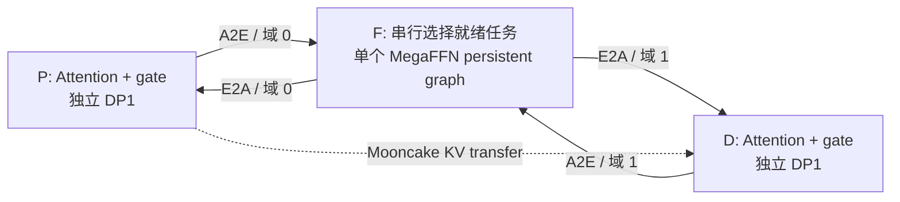

# 独立 P / D Attention，共享单个 FFN

`CAMP2pAFDConnector` 的实验性 `independent_attention` 模式让 P、D 各自运行在
独立的 vLLM DP1 实例中。一个 A 有请求时，另一个 A 不需要执行配套 dummy step。
默认关闭此模式，原有 DP 组内同步方式保持原行为。



## 配置

三方都使用 `num_attention_ranks=2`、`num_ffn_ranks=1` 和相同的 AFD host/port。
每个服务的 vLLM 本地并行配置为 **DP1 / TP1 / PP1 / PCP1 / DCP1**。
不要把 P、D 配进同一个 DP2 组。

下面是 P 的 `additional_config.afd` 示例；D 将 `attention_id` 改为 1；
F 将 `role` 改为 `ffn`，并**删除** `attention_id`。

```json
{
  "role": "attention",
  "connector": "CAMP2pAFDConnector",
  "host": "127.0.0.1",
  "port": 38270,
  "num_attention_ranks": 2,
  "num_ffn_ranks": 1,
  "compute_gate_on_attention": true,
  "ffn_compute_backend": "mega_ffn",
  "mega_ffn_execution_mode": "persistent",
  "afd_process_group_timeout_s": 180,
  "connector_extra_config": {
    "independent_attention": true,
    "attention_id": 0,
    "hccl_buffer_size": 256,
    "ffn_core_num": 4,
    "quant_mode": 0
  }
}
```

所有服务使用 `--enforce-eager`；不支持 DBO、ubatching、speculation。
预留连续的 `num_attention_ranks + 1` 个端口：例中 38270 为 P/F，38271 为 D/F，
38272 为 F 自身的 MoE group。每个 A 必须配置唯一且在范围内的 `attention_id`。
Mooncake 的 prefill/decode 拓扑也都改为 `dp_size=1`，KV 协议本身沿用现有实现。

## 实际执行顺序

1. 每个 A 与 F 建立独立的两 rank HCCL 域；域内 F rank=0、A rank=1。
2. A 把本轮 token 数等小型控制消息写入该域的 `PrefixStore`，按序号保存。
   hidden states、routing 结果与 FFN 输出仍走已有 A2E/E2A。
3. F 轮询两个 mailbox，在已就绪来源间轮转；只取被选中 A 的 metadata，
   切换到对应 HCCL 域，执行完整模型 step，不把 P/D batch 拼接或补齐。
4. F 完成本轮并同步当前计算 stream 后，再选下一来源。
   MegaFFN 的 persistent graph 和固定 IO buffer 被顺序复用，不随 P/D 切换重启。

同一 A 的后续 metadata 可以由 host 提前提交；编号消息保证 FIFO，
设备 stream 保证下一次 A2E 排在前一次 E2A 之后。
控制消息到达并不保证设备输入已经就绪，因此选中后的输入等待仍会占用 F。

## 生命周期与边界

- 启动时所有配置的 A 都必须加入；完成初始化后，各侧请求独立推进。
  不支持热加入、单边掉线恢复或单边重启；故障后按整组服务重启处理。
- F 按完整 step 串行服务两侧，不能抢占长 P step，也没有实现设备侧全异步调度。
- 正常退出先取消空闲 mailbox 等待，等待当前 F step 完成，再释放通信和模型资源。
  执行异常或等待超时不能证明设备已排空，必须保留资源并报错；重复 shutdown
  也不能清除这类错误后继续释放资源。
- persistent MegaFFN 仍沿用当前单层、BF16 输入权重转换等限制。
  本次实卡证据使用单层 DeepSeek V4 结构和 dummy BF16 权重，验证的是链路、
  KV 传输与生命周期，不代表完整 DeepSeek V4 权重或精度验证。
- 此模式有 host 侧控制消息和轮询，不等于 async dispatch/combine 的设备侧通信方案。

## 观察运行来源

vLLM 默认日志配置未必输出 `afd_plugin` 的 INFO 日志。实验的 Python logging 配置
需显式为 `afd_plugin` 配置 handler 和 INFO level，并通过
`VLLM_LOGGING_CONFIG_PATH` 加载。F 每轮日志包含：

```text
Independent CAMP2p step: attention_id=0 tokens=[63] profile=False
Independent CAMP2p step: attention_id=1 tokens=[1] profile=False
```

启动 profile 会分别处理两个来源；验证运行期独立性时，应在两侧 `/health` 就绪后
对每个请求的日志区间分别计数。
